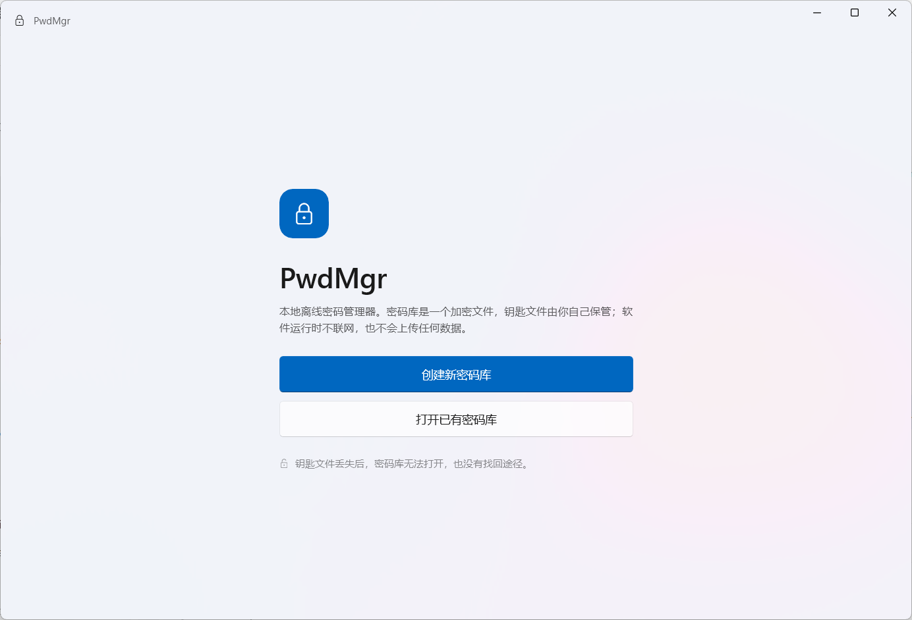
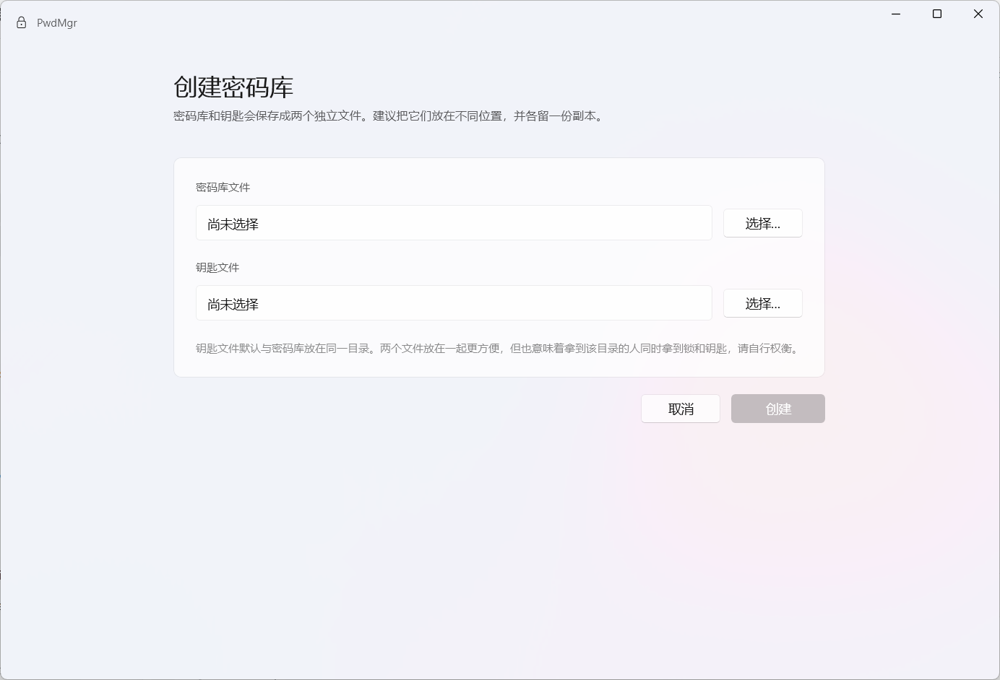
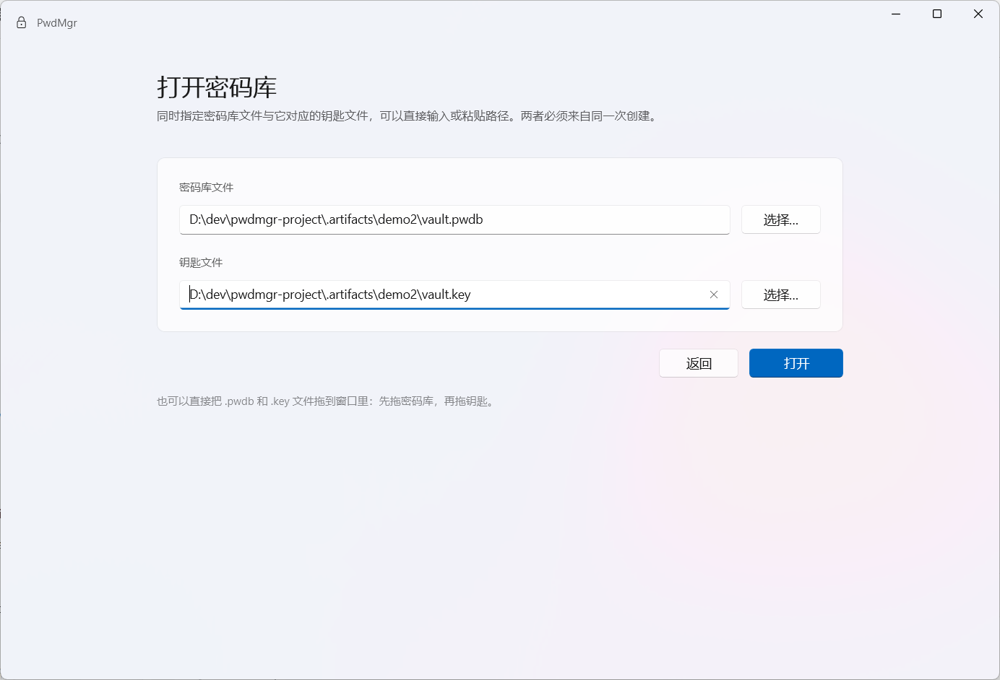
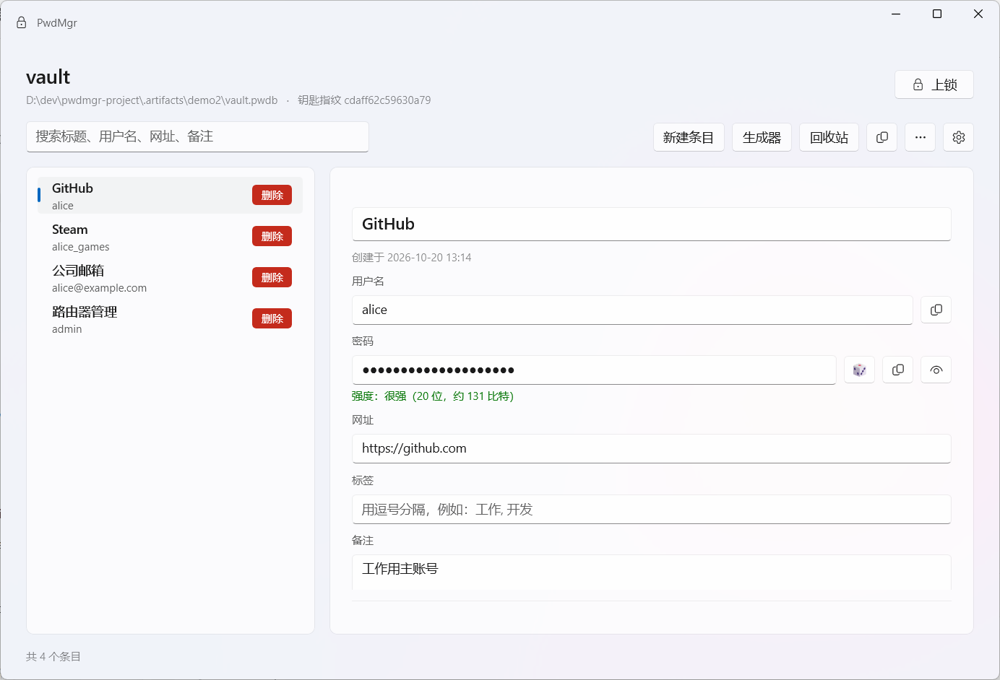
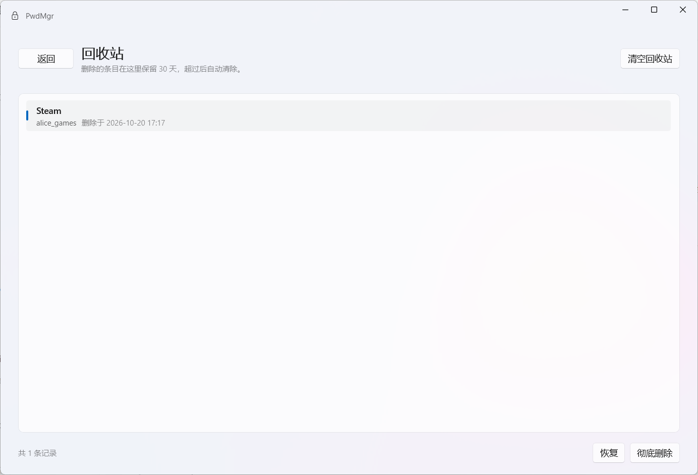
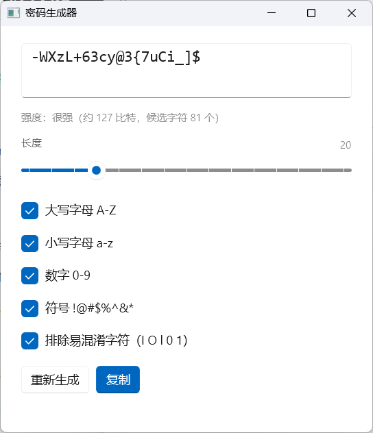

# PwdMgr

本地离线密码管理器（Windows / C# / WinUI 3）。数据只存在两个文件里：加密的密码库 + 你保管的钥匙文件。软件运行时不联任何网。

> 当前进度：**M1 完成**（Core 加密与存储）、**M2 完成**（WinUI 3 界面骨架）、**M3 完成**（新增/删除条目、回收站、自动锁定）、**M4 完成**（密码生成器、剪贴板）、**M5 完成**（备份/校验/恢复、错误提示）。
> 剩余：M6（绿色版打包与验收）。

## 界面

| 欢迎页 | 创建密码库 |
|---|---|
|  |  |

| 打开密码库 | 主界面 |
|---|---|
|  |  |

| 回收站 | 密码生成器 |
|---|---|
|  |  |

条目字段直接可改，出现改动后卡片底部出现“保存修改 / 放弃修改”。每个列表项右侧有红色“删除”按钮，点击后二次确认，删除的条目进入回收站；回收站里每项可“恢复”或“彻底删除”（红色），也可清空回收站。密码框右侧有“🎲”按钮直接生成密码，密码框下方显示强度（弱/中等/强/很强 + 估算比特数），用户名和密码旁都可以一键复制（30 秒后自动清空剪贴板）。闲置 5 分钟或锁屏时自动上锁；上锁后只保留密码库路径，钥匙路径会被清空，需要重新选择钥匙文件才能再次打开。

创建与打开页面既可以用“选择…”挑文件，也可以直接输入或粘贴路径（输入库路径时会自动补出钥匙路径）。欢迎页的图标与标题居中显示。窗口有最小尺寸（900×640），防止被拖得过窄后内容被裁切；密码生成器窗口最小 460×560。

界面使用 WinUI 3 + Fluent 主题资源 + Mica 背景。默认跟随系统深色/浅色；也可以点右下角（主界面工具栏最右）的齿轮，选“跟随系统 / 浅色 / 深色”，选择会保存到 `%LOCALAPPDATA%\PwdMgr\settings.json`。

## 目录结构

```
PwdMgr.sln
build.ps1                      用 Visual Studio 的 MSBuild 构建整个解决方案
src/PwdMgr.Core/               加解密、文件格式、存取、数据模型（无界面、可单测）
src/PwdMgr.App/                WinUI 3 界面：页面、ViewModel、文件选择、窗口
tests/PwdMgr.Core.Tests/       xUnit 测试
tools/PwdMgr.Cli/              开发期命令行工具，用于无界面验证存储
docs/技术方案-v1.md            技术方案与设计决策
docs/ui/                       界面截图
```

## 环境要求

- Windows 10 1809+ / Windows 11
- .NET SDK 8.0 或更高（项目目标框架 `net8.0` / `net8.0-windows10.0.19041.0`）
- **Visual Studio 2022 / 2026**（安装「Windows 应用开发」或「.NET 桌面开发」工作负载）
  - WinUI 3 工程依赖 VS 自带的 Appx MSBuild 任务，`dotnet build` 无法编译 `PwdMgr.App`。

## 构建

```powershell
.\build.ps1                      # Debug（PowerShell 执行策略允许运行时）
.\build.ps1 -Configuration Release
```

如果系统把执行策略设成 `AllSigned`（提示“脚本未数字签名”），改用批处理脚本，它不受执行策略限制：

```cmd
build.cmd
```

两个脚本都会用 `vswhere` 找到 Visual Studio 的 MSBuild 再编译整个解决方案。也可以在 Visual Studio 里直接打开 `PwdMgr.sln` 构建。

> 环境说明：`build.cmd` 会把 `TMP`/`TEMP` 指向项目内的 `.artifacts\temp`。
> 有些做了安全加固的机器只允许未签名程序写项目目录，这时 Windows SDK 的 `MakePri.exe`
> 会因写不了系统临时目录而以 `0x80070005` 失败，导致构建中断；重定向后即可正常构建。

### 创建密码库时提示“无法在这个文件夹里创建文件”

先看程序目录下的 `startup.log`，开头的“临时目录/程序目录/用户目录 可写=是/否”会指出问题：

- 三个都是“否”：程序被安全策略限制，只能把库建在可写目录，或给程序签名/放行；
- 只有目标目录是“否”：换一个有写入权限的文件夹即可。

程序日志在：

```
src\PwdMgr.App\bin\x64\Debug\net8.0-windows10.0.19041.0\win-x64\startup.log
```

### 请勿直接从本仓库的 bin 目录运行程序

本开发机上，`D:\dev\pwdmgr-project` 目录带有环境加的特殊权限标记，其中的可执行文件会被当作不可信程序（进程降为低完整性，写不了任何普通目录，连系统记事本复制进去都打不开）。**构建可以在这个目录做，运行请用复制到项目目录之外的副本**：

```cmd
robocopy "src\PwdMgr.App\bin\x64\Debug\net8.0-windows10.0.19041.0\win-x64" "%LOCALAPPDATA%\PwdMgrApp" /E
"%LOCALAPPDATA%\PwdMgrApp\PwdMgr.App.exe"
```

只构建不依赖界面的部分（Core / CLI / 测试）时，仍然可以用 dotnet CLI：

```powershell
dotnet build tests/PwdMgr.Core.Tests/PwdMgr.Core.Tests.csproj -m:1
```

## 运行

```powershell
.\src\PwdMgr.App\bin\x64\Debug\net8.0-windows10.0.19041.0\win-x64\PwdMgr.App.exe
```

也支持带参数直接打开一个密码库（便于验收与调试）：

```powershell
.\PwdMgr.App.exe .\demo\vault.pwdb .\demo\vault.key
```

## 测试

```powershell
dotnet test tests/PwdMgr.Core.Tests/PwdMgr.Core.Tests.csproj
```

如果所在环境的测试宿主无法启动（例如受限沙箱禁止命名管道），直接运行测试程序：

```powershell
dotnet tests\PwdMgr.Core.Tests\bin\Debug\net8.0\PwdMgr.Core.Tests.dll
```

测试覆盖：加密往返、错钥匙、密文/头部篡改、截断、版本不符、缺文件、并发占用、备份与恢复、明文不落盘、条目增删改查与搜索、回收站、密钥文件校验。

## 命令行工具（仅开发期使用）

```powershell
# 创建密码库与钥匙（两个文件请分开保管）
dotnet run --project tools/PwdMgr.Cli -- create .\demo\vault.pwdb .\demo\vault.key

# 添加一条
dotnet run --project tools/PwdMgr.Cli -- add .\demo\vault.pwdb .\demo\vault.key --title GitHub --username alice --password "s3cret!"

# 列出条目
dotnet run --project tools/PwdMgr.Cli -- list .\demo\vault.pwdb .\demo\vault.key
```

## 安全模型（摘要）

- 密码库：AES-256-GCM 整体加密，密文前有明文头部（算法标识、钥匙指纹、被包裹的数据密钥）。
- 钥匙文件：RSA-3072 私钥（PKCS#8，Base64）。**私钥不加密**，也就意味着「钥匙文件 + 密码库」同时泄露即等于数据泄露。
- 每次保存换随机 nonce，先写临时文件、落盘、再替换，并保留 `.bak`；写入后立即读回校验。
- 钥匙文件丢失后没有任何找回机制。请把它复制到与密码库不同的位置保管。
- 界面不提供「打开网址」按钮，避免把浏览器联网行为带进流程。

## 已知限制

- 条目可以查看、编辑、新增和删除：改动后底部出现保存条；切换条目、搜索、上锁、关窗前会自动保存，保存失败时会拦下操作并提示。
- 删除是软删除：条目先进入回收站，可恢复、可彻底删除，超过 30 天自动清除。
- 闲置 5 分钟或系统锁屏时自动上锁，回到解锁页。
- 工具栏“更多”里可以**创建备份**、**检查密码库**、**从备份恢复**：备份是加密的完整副本，恢复时需要同一把钥匙；每次保存还会自动保留上一版为 `.bak`。
- 同一个密码库被两个窗口打开时，第二个窗口会提示“这个密码库正在被另一个窗口使用”。
- 密码生成器有两处入口：工具栏“生成器”打开独立窗口；密码框旁的“🎲”直接生成并填入（已有内容会先确认）。
- 复制用户名/密码后 30 秒自动清空剪贴板；若期间你复制了别的内容则不会误清。剪贴板历史的排除依赖系统支持（`CanIncludeInClipboardHistory` 等格式），属于尽力而为。
- 生成器的长度与字符选项暂不保存，重启后回到默认值（长度 20、全字符集、排除易混淆字符）。
- 快捷键：`Ctrl+N` 新建、`Ctrl+G` 生成器、`Ctrl+F` 搜索、`Ctrl+L` 上锁、`Ctrl+S` 保存。
- 程序目录下的 `startup.log` 记录启动与异常信息（Debug 构建记录每个启动步骤，Release 只记录异常），可随时删除。


